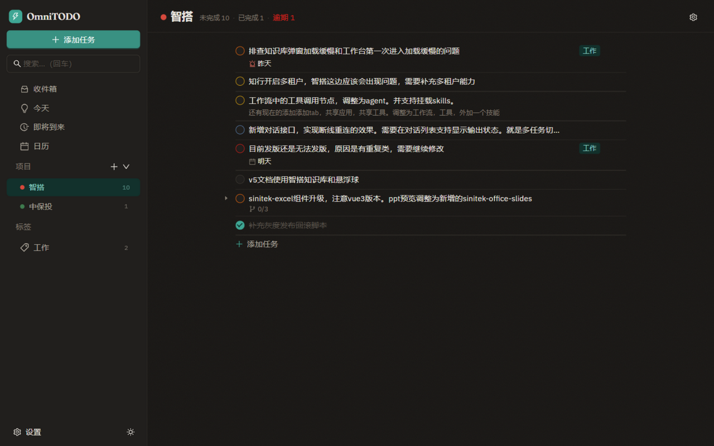
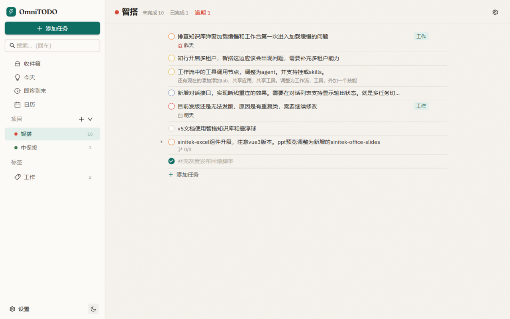
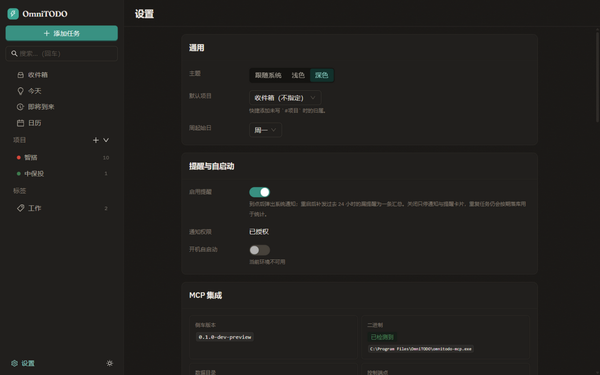

# OmniTODO

**本地优先的桌面待办应用。** 数据只落在本机一个 SQLite 文件里——没有账号、没有服务端、
断网也能完整使用；同时内置一个原生 MCP Server，把这份任务库开放给 AI agent 读写
（默认只读，写入需显式开启）。

[](https://github.com/yunqilee69/OmniTODO/actions/workflows/release.yml)
[](https://github.com/yunqilee69/OmniTODO/releases)
[](./LICENSE)


| 深色 | 浅色 |
| --- | --- |
|  |  |

（截图由 `ui/dev-preview.html` 的 stub 数据渲染，不是真实用户数据。）

## 特性

**组织**

- 收件箱 / 今天 / 即将到来 / 日历 四个入口，外加项目、标签两套维度
- 子任务（父任务行上卷显示进度）、优先级（无 / 低 / 中 / 高 / 紧急）、描述
- 拖拽排序；落点缩进越过某行就把它收为子任务，拖回原缩进则还原成同级
- 日历月 / 周视图：重复任务的未来期次以虚线预告，拖动即改期

**输入**

- 快速添加一行搞定：`写周报 #工作 @汇报 !高 ^明天 18:00 *每周五 ::附上本周进展`
- 全局快捷键 `Ctrl/Cmd+Shift+Space` 随时唤起快速添加；托盘菜单也能进
- 导入 Todoist JSON / Markdown / todo.txt，导出 JSON / CSV / Markdown

**时间**

- 开始 / 截止时间；纯日期按全天存（不做时区换算，不会「跨时区变成前一天」）
- 重复规则：RFC 5545（`FREQ=WEEKLY;BYDAY=MO,WE,FR`）或中文简写（`每周一,三,五`）
- 提醒到点弹系统通知；重启后把过去 24 小时的漏提醒汇总成一条，不刷屏
- 统计报告：完成数、吞吐曲线、平均完成耗时、准时率

**其它**

- 全文搜索（SQLite FTS）
- 附件随库托管在数据目录，`omnitodo maintain` 回收孤儿附件
- 明 / 暗 / 跟随系统三种主题；中文与英文界面
- `omnitodo://task/<id>` deep link 直接聚焦任务；单实例运行
- 所有写操作（应用内与 MCP 都一样）记入 `op_log`，可审计

## 下载安装

安装包在 [Releases](https://github.com/yunqilee69/OmniTODO/releases) 页面，由
[`.github/workflows/release.yml`](./.github/workflows/release.yml) 从 `v*` 标签自动构建：

| 平台 | 安装包 | 首次运行 |
| --- | --- | --- |
| Windows | `OmniTODO_<版本>_x64-setup.exe`（NSIS）、`.msi`（WiX） | 未签名，会触发 SmartScreen，选「仍要运行」 |
| macOS | `OmniTODO_<版本>_universal.dmg`（Intel + Apple Silicon） | 未签名、未公证，右键→打开，或 `xattr -dr com.apple.quarantine /Applications/OmniTODO.app` |
| Linux | `.deb` / `.AppImage` / `.rpm` | deb 走系统依赖，AppImage 需 `chmod +x` |

`omnitodo-mcp` 作为侧车（sidecar）打在安装包里，用户不需要单独下载。

## 快速上手

首次启动会自动建库，数据目录是 `~/.omnitodo/`（Windows 为 `%USERPROFILE%\.omnitodo\`），
DB 是其中的 `omnitodo.db`，附件在 `attachments/`。侧栏「添加任务」或 `Ctrl/Cmd+Shift+Space`
都能开始输入。

快速添加一行里的记号（`ui` 与 CLI 共用同一个解析器）：

| 记号 | 含义 | 例子 |
| --- | --- | --- |
| `!` | 优先级 | `!高` `!紧急`（也认 `p3` / `high`） |
| `#` | 项目 | `#工作`（名字对不上时弹选择器，列出相近的项目） |
| `@` | 标签 | `@汇报` |
| `^` | 截止日期 | `^明天` `^2026-10-20` `^+3d` |
| `>` | 开始日期 | `>下周一` |
| 裸时间 | 接在最近的日期记号后 | `^明天 18:00` |
| `~` | 提前多久提醒 | `~30m` `~2h` |
| `*` | 重复规则 | `*每天` `*每周一,三,五` |
| `::` | 描述（其后原样保留） | `::重点看交互` |

日期也认 `今天/明天/后天/下周一`、`2026-10-12 18:30`、`+3d` 或原始毫秒。写错的记号不会
被静默吞掉——认不出来就留在标题里。

## 让 AI 读你的待办（MCP）

`omnitodo-mcp` 是一个独立的 MCP Server，直接读同一个 SQLite 文件，因此桌面应用关着也能用。
默认只注册 **13 个只读工具**（项目、任务、子任务、标签、附件、搜索、日历、临近任务、提醒计划、
统计报告、导出）；在设置页打开「允许 MCP 写入」后才注册另外 **7 个写工具**
（新建 / 修改 / 完成 / 删除 / 加子任务 / 加标签 / 移动）。



设置页会按客户端生成可直接粘贴的配置（ZCode、通用 `mcpServers` JSON 都有），并给出侧车
绝对路径、数据目录、控制端点状态。手写的话是：

```jsonc
// stdio：每个客户端各自拉起一个实例，无需端口或 token
{
  "mcpServers": {
    "omnitodo": {
      "command": "/absolute/path/to/omnitodo-mcp",
      "args": ["--db", "/home/you/.omnitodo/omnitodo.db"]
    }
  }
}
```

```bash
omnitodo-mcp --db "<数据目录>/omnitodo.db"              # stdio，只读
omnitodo-mcp --db "<数据目录>/omnitodo.db" --write       # 额外注册写工具
omnitodo-mcp --db "<数据目录>/omnitodo.db" --http --port 8787 --token <token>  # 常驻 HTTP
```

常驻 HTTP 只监听 `127.0.0.1` 且要求 `Authorization: Bearer <token>`；token 存在 `settings`
表里，重启不变，可在设置页修改或重新生成。传入
`--notify http://127.0.0.1:8788/internal/notify --notify-token <t>` 后，写工具提交成功会回调
桌面应用的控制端点刷新界面。

## 命令行

`omnitodo` 是与桌面端共享 `omnitodo-core` 的 headless CLI，用来做脚本、维护与冒烟测试：

```bash
cargo run -p omnitodo-cli -- init
cargo run -p omnitodo-cli -- project add "工作"
cargo run -p omnitodo-cli -- task add "写周报" --project 工作 --priority 3 --tag 汇报 --due 明天
cargo run -p omnitodo-cli -- quickadd "评审设计稿 !紧急 @设计 ^明天 18:00 ::重点看交互"
cargo run -p omnitodo-cli -- search "设计稿"
cargo run -p omnitodo-cli -- report --days 7
cargo run -p omnitodo-cli -- import backup.json --format todoist   # 也支持 markdown / todotxt
cargo run -p omnitodo-cli -- export --format json
cargo run -p omnitodo-cli -- maintain    # 清 op_log、回收附件、重建 FTS
```

全局 `--db <path>` 覆盖数据库位置，`OMNITODO_DATA_DIR` 覆盖整个数据目录。

## 仓库结构

```
crates/
  omnitodo-core/   # 纯逻辑库：domain / db / repo / service，无 Tauri、无 MCP
  omnitodo-cli/    # headless CLI：冒烟测试、脚本、维护命令（bin: omnitodo）
  omnitodo-mcp/    # 独立 MCP server：stdio + streamable HTTP（bin: omnitodo-mcp）
omnitodo-desktop/  # Tauri 2 桌面壳（需 WebView 系统库，独立构建，见下）
ui/                # React 19 + TS + Vite 前端（组件层 Ant Design v6）
docs/              # 实现进度、打包说明、专题设计
scripts/           # check.sh、图标生成、侧车构建、打包、Xvfb 冒烟
```

三端产物是同一份 `omnitodo-core`：桌面端通过 Tauri command 调它，CLI 与 MCP Server 直接
依赖它。桌面壳被排除在根 workspace 之外，所以 `cargo test --workspace` 不需要 WebView 系统库
就能跑完。

前端组件层用 **Ant Design v6**，但不是 antd 默认观感：配色、圆角、字体按
[`DESIGN.md`](./DESIGN.md)（「静默工坊」）通过 `ConfigProvider` 的 `theme` 令牌注入
（映射见 `ui/src/theme/antd.ts`），明/暗/跟随系统三态同时驱动 antd 的
`defaultAlgorithm`/`darkAlgorithm` 与自留的 `[data-theme]` CSS 变量。行为库各司其职：
`@tanstack/react-query`（服务端状态）、`zustand`（UI 状态）、`react-router-dom`（路由）、
`@dnd-kit`（拖拽排序与日历改期）、`@tanstack/react-virtual`（超过 60 行才开窗）、`i18next`。
字体自托管（Fraunces 展示体 + IBM Plex Sans/Mono，中文回退系统字体）。日历网格与列表容器
是两处刻意的自绘（antd `Calendar`/`List` 会丢跨格拖拽与虚拟化），理由见 `DESIGN.md` §15。

## 开发

需要 Rust stable 与 Node 20+。首次构建会编译 `sqlx` 与 bundled SQLite。

```bash
scripts/check.sh                # cargo test + clippy + 前端单测/打包，一条命令全绿
cargo test --workspace          # core + cli + mcp，49 个测试
cargo clippy --workspace --all-targets

cd ui && npm install && npm test && npm run build   # 前端 118 个单测 + 严格类型检查 + 打包
```

桌面端依赖 WebView 系统库（WebView2 / WebKitGTK / WKWebView），随 GUI 环境单独构建：

```bash
cd omnitodo-desktop && npm install
npx tauri dev        # 会拉起 ui 的 vite dev server（先在 ui/ 装一次依赖）
```

只想看界面、不想装 GUI 依赖：`cd ui && npm run dev`，然后打开
`http://localhost:5173/dev-preview.html`（用 stub IPC 喂数据，可加 `?route=/settings` 指定路由）。

### 页面级冒烟

无 GUI 会话也能验收：脚本把**打包好的产物**跑在 Xvfb 虚拟屏上，用 `xdotool` 合成点击走完各页面，
逐步截图，并断言点击真的写进了 SQLite。

```bash
scripts/smoke-gui-xvfb.sh --bin /usr/bin/omnitodo-desktop --cli target/release/omnitodo
scripts/smoke-notification-xvfb.sh --bin /usr/bin/omnitodo-desktop --cli target/release/omnitodo
scripts/smoke-shortcut-xvfb.sh       --bin /usr/bin/omnitodo-desktop --cli target/release/omnitodo
scripts/smoke-deeplink-xvfb.sh       --bin /usr/bin/omnitodo-desktop --cli target/release/omnitodo
```

分别验证：各页面能点通且勾选/稍后提醒等真的改库；**到点真的弹系统通知**（起一个 dunst 守护进程
核对）；**全局快捷键真的能唤起快速添加**；**deep-link 真的能聚焦任务**。`--bin` 要传生产构建
——手工 `cargo build --release` 必须带 `--features custom-protocol`，否则 webview 会去连 `devUrl`
而不是加载内嵌资源，页面全是白的。

## 打包

```bash
scripts/package.sh                     # 本平台默认：Linux deb/appimage/rpm；macOS dmg/app
scripts/package-linux-docker.sh        # 无 GUI / 无 root 的 Linux 机器用容器构建
scripts/package-windows-cross.sh nsis  # 在 Linux 上交叉构建 Windows 安装包（未签名）
```

脚本顺序固定：构建 `ui/dist` → 编译 `omnitodo-mcp` 侧车并按目标三元组命名 → `tauri build`。
图标由 `scripts/gen-icon.mjs` 生成源图后用 `tauri icon` 派生全套。

推 `v*` 标签会走 CI（Windows nsis+msi / macOS universal dmg / Linux deb+AppImage+rpm，
标签号必须与 `omnitodo-desktop/tauri.conf.json` 的 `version` 一致）。细节、macOS 的
`.dmg` 构建注意事项、依赖声明与实测结论见 [`docs/packaging.md`](./docs/packaging.md)。

## 文档

| 文件 | 内容 |
| --- | --- |
| [`DESIGN.md`](./DESIGN.md) | 视觉规范（配色、排版、布局、组件令牌） |
| [`2026-10-12-todo-desktop-design.md`](./2026-10-12-todo-desktop-design.md) | 完整设计说明：领域模型、存储、服务、MCP、交付分期 |
| [`docs/implementation-status.md`](./docs/implementation-status.md) | 实现进度与各轮验证记录 |
| [`docs/packaging.md`](./docs/packaging.md) | 打包、侧车机制、CI 发布 |
| [`docs/2026-10-15-mcp-endpoint-token-design.md`](./docs/2026-10-15-mcp-endpoint-token-design.md) | MCP 控制端点与 token 持久化 |

## 贡献

欢迎 issue 与 PR。改动前先跑一遍 `scripts/check.sh`（它同时覆盖 Rust 与前端）；
提交信息沿用仓库现有的 [Conventional Commits](https://www.conventionalcommits.org/) 风格
（`fix(ui): …` / `feat(core): …`）。文档、注释与提交信息目前都是中文，保持一致即可。

## 许可证

[MIT](./LICENSE)
